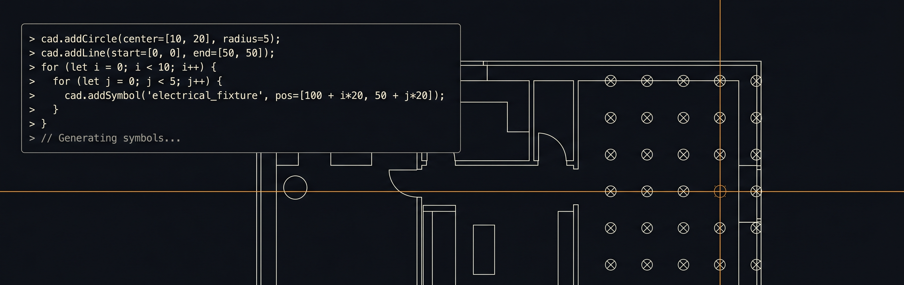

<p align="center" style="font-size:2em;font-weight:bold">CodeCAD</p>

**CodeCAD: CAD you can program.** Exact 2D drawings and 3D solid models
from one script. Drawings are what you hand over. Models are where you
think.

Write a script that models parts, checks them with rules you write, and
documents them: drawings, part lists, DWG and PDF. Every operation is a
function call, so an AI agent can drive it too. Open .dwg files in the
browser and edit them live across browsers.

The name is the design. **Code** brings the meaning: the use case, the
domain, the rules. **CAD** is the core: generic, exact drawing and shape
work. The two meet in one function-call API, built agent-first.

<p align="center">
  
</p>

**[Try it in your browser](https://backkem.github.io/codecad/app/)** -- no install needed.
**[Examples](https://backkem.github.io/codecad/gallery.html)**: models and
drawings, each with its script.

Built in Rust and WASM. No license server, no vendor lock-in. You own the
tool and the data.

## Features

**Drawings (2D)**, in the browser with no backend, and on the server:

- **DWG viewer**: opens .dwg files (R13-R2018) with infinite vector zoom.
  Dual renderer: Vello (GPU compute, WebGPU) with egui CPU fallback.
- **Multi-document tabs**: several drawings side-by-side, each with
  isolated camera, layers, and undo history.
- **Scriptable**: every drawing operation is a `cad_call(method, args_json)`
  you can drive from the browser console or your own code.
- **Output**: DWG and PDF from the server.

**Models (3D)**, built on the server:

- **Solid parts**: extrude, revolve, sweep, loft, cut, union, holes,
  fillets and chamfers, kept as exact feature trees. Copies share one
  definition; attributes say what a part is.
- **Checks**: set queries (overlaps, contacts, distances, containment) for
  rules you write in script.
- **Renders**: a fast working render and a path-traced presentation
  render, to PNG.
- **Drawings from models**: exact projected views (`cad.project`) for
  shop drawings, and part lists from attributes.
- **In the browser**: a prebaked scene (`cad.bake3d`) opens without a
  kernel, in both render modes (WebGPU). An optional kernel module
  (`just build-kernel`) lets a page build parts itself; the public site
  does not ship it.

**With server**: run `cadview-server` for persistence, sync, and automation:

- **Real-time sync**: edits propagate instantly to all connected browsers
  via Yrs CRDT over WebTransport.
- **Server-side scripting**: JS in a [codelib](https://github.com/backkem/codelib)
  sandbox (wasmtime) with direct document access. Mutations batch and broadcast to all viewers.
- **HTTP API**: `POST /api/run` to execute scripts from curl, CI, or MCP.

**General by design**: the core knows geometry, not what it means. A floor
plan, a schematic, a machine part or a play tower is your script's
knowledge, built on the same generic calls and queries.

**Direction**: models as the input to fabrication (3D printing, CNC). Not
a feature today.

## Install

Grab a binary from the [latest release](https://github.com/backkem/codecad/releases/latest).
One file, no runtime deps: the frontend, the WASM renderer and the
script sandbox are all baked in.

```bash
# Linux / macOS (pick your target triple)
tar xzf codecad-v0.1.0-x86_64-unknown-linux-gnu.tar.gz
./codecad-v0.1.0-x86_64-unknown-linux-gnu/codecad path/to/file.dwg
```

Windows: unzip and run `codecad.exe`. On macOS, first run needs
`xattr -d com.apple.quarantine codecad` (the binaries are unsigned).

Builds are published for Windows x64, Linux x64/arm64, and macOS
Intel/Apple Silicon. Run `codecad --help` for flags.

## Quick start

Building from source needs `wasm-bindgen-cli`, Node.js + pnpm, and
[just](https://github.com/casey/just).

```bash
just build   # WASM + frontend + server

# Serve a DWG
RUST_LOG=info cargo run -p cadview-server --release -- path/to/file.dwg

# Or a folder of DWGs
RUST_LOG=info cargo run -p cadview-server --release -- --dir ./drawings/
```

Opens at http://localhost:8765. Drag-and-drop .dwg files onto the page.

## Architecture

Three Rust crates (plus the `mtext` helper), one TypeScript + React frontend:

| Crate | Role |
|-------|------|
| `cadview-core` | Document model, DWG parsing, `cad_call` dispatcher, Yrs CRDT sync. Compiles for wasm32 and native. Zero global state. |
| `cadview-web` | WASM browser target: session registry, dual renderer (Vello + egui), wasm-bindgen exports. |
| `cadview-server` | HTTP (axum) + WebTransport (wtransport). Document store, lazy loading, per-doc broadcast, server-side JS scripts on [codelib](https://github.com/backkem/codelib). |

See [docs/architecture.md](docs/architecture.md) for the full design and
[AGENTS.md](AGENTS.md) for contributor/agent orientation.

## Docs

- [API surface](docs/api-surface.md) -- full JS API, block system, worked exercises
- [Drawing skill](SKILL.md) -- techniques, patterns, fillet/offset rules
- [2D examples](examples/index.md) and [3D examples](examples/3d/index.md) -- scripts with their outputs
- [Contributing](CONTRIBUTING.md) -- build, test, code style

## License

[MIT](LICENSE)
