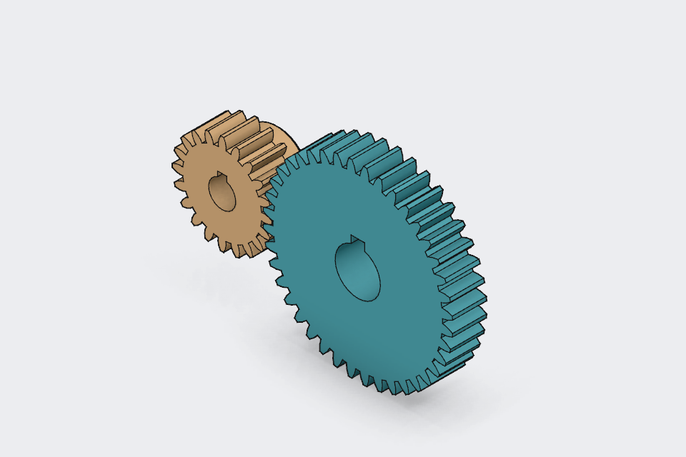
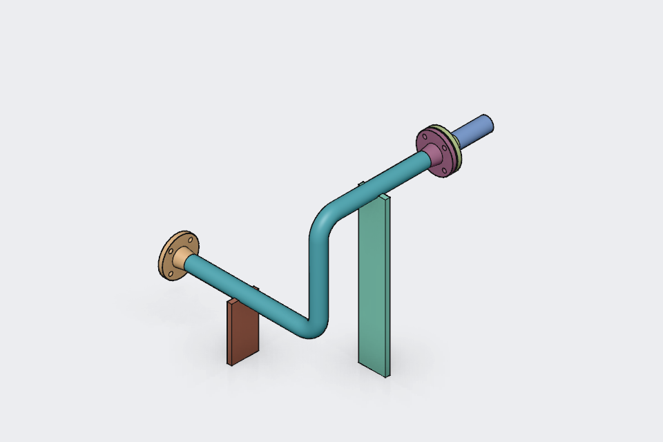
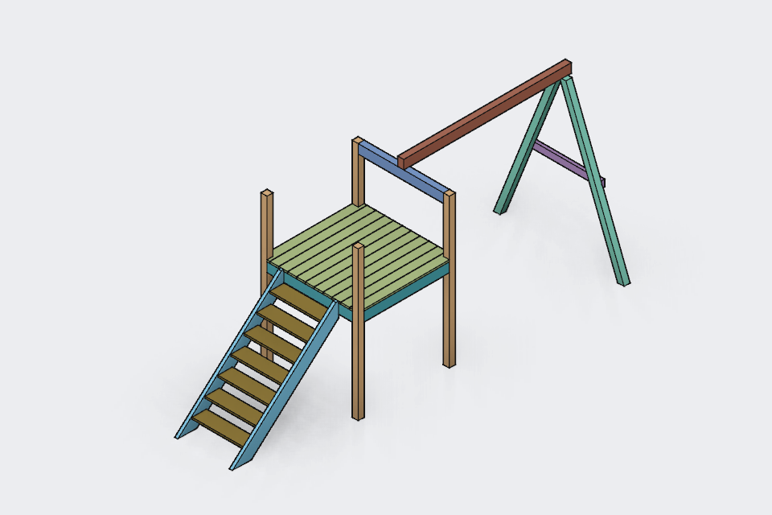

# CodeCAD 3D examples

Solid models made with the CodeCAD JavaScript API, from the target list in
[`docs/3d-examples.md`](../../docs/3d-examples.md). Each script builds its
parts, checks them against values it computes itself (part counts, exact
volumes from closed forms, boxes against the design sizes) and fails if a
check does not hold, then writes a shaded working render: the isometric
one next to the script, the other views to `target/3d-views/`. It returns a
short summary: parts, definitions, total volume, box, checks, files and
times.

Shared code lives in [`lib/`](lib): [`shapes.js`](lib/shapes.js) (boxes,
members between two points, rounded rectangles, slots, bolt circles,
arcs through three points, and the closed forms the checks use),
[`checks.js`](lib/checks.js) (checks, renders and the summary) and
[`flange.js`](lib/flange.js) (the weld-neck flange of 01, placed again by
07). They are scripts that use only the public `cad.*` API, loaded with
`await cad.use("shapes")`.

## Reproducing

```bash
# from the repository root; needs a GPU for the renders
cargo run -p cadview-server --release -- --exec examples/3d/03-bookshelf.js
```

Repeated parts are copies of one definition (`copy3d`); attributes name
what each part is (`part`, `member`, `material`). Interference and
clearance checks are a later rung; where an example wants one, its script
says so in a comment.

## 01 - Pipe flange

A DN50 weld-neck flange: a disc Ø165 x 18 with a raised face, a hub
tapering to the Ø60.3 weld end, a Ø52.5 bore, four Ø18 bolt holes and 1 mm
chamfers. One revolve of exact lines, then chamfers and holes. Shows a
turned part and a half cutaway through the axis.

[JS source](01-pipe-flange.js)


## 02 - Mounting bracket

An L-bracket from 6 mm plate with an R6 inside bend, a gusset, two
counterbored holes, two slots and R3 corners. One extrude of a side
profile with exact bend arcs; slots are cuts of lines and half circles.

[JS source](02-mounting-bracket.js)


## 03 - Bookshelf

The worked example of `docs/3d-design.md`: 800 x 1800 x 300, two sides
with dados for five shelves, a top, a back panel in a rabbet and three
rails, twelve parts. The joints are cut with the parts themselves
(`cut(side, {part: shelf})`); the shelves share one definition. Exploded
and front views.

[JS source](03-bookshelf.js)


## 04 - Electronics enclosure

A 100 x 60 x 25 case in two halves with 2 mm walls, corner bosses with
screw holes, a board on four standoffs with its larger components as
blocks, and cut-outs for a connector and a jack. Pockets of rounded
rectangles, bosses as unions, holes. Views with the lid lifted and from
the top.

[JS source](04-enclosure.js)


## 05 - Piston and connecting rod

A Ø80 piston with three ring grooves (one revolve), pin bosses with blind
pin bores, a hollow pin, and a rod 140 between centres whose outline is two
circles joined by tangent lines. A quarter cutaway shows them in section.
The bosses are blocks and the pin bores stop short of the skirt: see the
script for why.

[JS source](05-piston-and-rod.js)


## 06 - Spur gear pair

Module 2, 20 and 40 teeth, meshed at 60 centre distance. Each gear is one
extrude of its whole outline, with one arc per involute flank, a hub, a
bore with a keyway and a chamfer. Front view.

[JS source](06-spur-gears.js)



## 07 - Pipe spool

A Ø60.3 x 3.9 line with two long-radius elbows, swept as one ring along
lines and arcs, three flanges from example 01 (one definition), a stub and
two saddle supports. Top view.

[JS source](07-pipe-spool.js)



## 08 - Turned stool

A round seat with rounded edges on three turned legs splayed 8°, with
beads and a cove (a revolve of lines and arcs), and three tapered
stretchers (ruled lofts). Legs and stretchers are placed by turning copies
about the axis. Front view.

[JS source](08-turned-stool.js)


## 11 - Play tower, timber frame

The frame of the flagship: four posts, a 1500 x 1500 platform at 1450 with
rims, joists and deck boards notched round the posts, a swing beam on a
head rail out to an A-frame, and stairs with stringers and treads. 36
parts in 12 definitions; angled members are cut level and plumb. Seen from
the south-west so the stairs face the viewer, exploded and from the front.

[JS source](11-play-tower-frame.js)


