# CodeCAD 3D examples

Solid models made with the CodeCAD JavaScript API, from the target list in
[`docs/3d-examples.md`](../../docs/3d-examples.md). Each script builds its
parts, checks them against values it computes itself (part counts, exact
volumes from closed forms, boxes against the design sizes) and fails if a
check does not hold, then writes a shaded working render: the isometric
one next to the script, the other views to `target/3d-views/`. It returns a
short summary: parts, definitions, total volume, box, checks, files and
times.

For the site, the isometric view is also written next to the script as a
presentation render (`NN-name-render.png`) and a prebaked scene
(`NN-name.bake3d`, which the site's 3D viewer shows without a kernel). A
sheet's DWG (`11-play-tower-partlist.dwg`, `12-projected-views.dwg`) goes
to `target/3d-views/`, because the DWG writer's bytes differ from run to
run: copy it over the committed one when the sheet changes.

Shared code lives in [`lib/`](lib): [`shapes.js`](lib/shapes.js) (boxes,
members between two points, rounded rectangles, slots, bolt circles,
arcs through three points, and the closed forms the checks use),
[`checks.js`](lib/checks.js) (checks, renders and the summary),
[`flange.js`](lib/flange.js) (the weld-neck flange of 01, placed again by
07), [`bookshelf.js`](lib/bookshelf.js) and [`stool.js`](lib/stool.js) (the
models of 03 and 08, placed again in the room of 09),
[`materials.js`](lib/materials.js) (named materials for presentation
renders), [`playtower.js`](lib/playtower.js) (the play tower of 11, built once
for both of its scripts), [`rules.js`](lib/rules.js) (rules for any model:
what rests on what, overlaps, free space, gaps that trap, guards along
edges), [`partlist.js`](lib/partlist.js) (a part list with a cutting plan,
bought items and fixings, from attributes), [`sheet.js`](lib/sheet.js)
(a drawing sheet with tables and a title block) and
[`guide.js`](lib/guide.js) (construction guides: one drawing per assembly
step from projected views, with labels placed clear of the drawing). They are scripts that use
only the public `cad.*` API, loaded with `await cad.use("shapes")`.

## Reproducing

```bash
# from the repository root; needs a GPU for the renders
cargo run -p cadview-server --release -- --exec examples/3d/03-bookshelf.js
```

Repeated parts are copies of one definition (`copy3d`); attributes name
what each part is (`part`, `member`, `material`). Interference and
clearance checks are a later rung; where an example wants one, its script
says so in a comment.

## 01 - Pipe flange

A DN50 weld-neck flange: a disc Ø165 x 18 with a raised face, a hub
tapering to the Ø60.3 weld end, a Ø52.5 bore, four Ø18 bolt holes and 1 mm
chamfers. One revolve of exact lines, then chamfers and holes. Shows a
turned part and a half cutaway through the axis.

[JS source](01-pipe-flange.js)

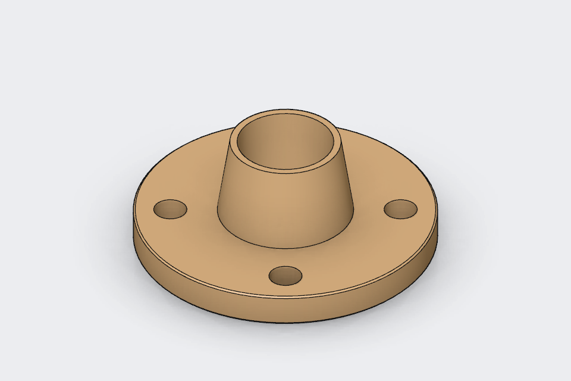

## 02 - Mounting bracket

An L-bracket from 6 mm plate with an R6 inside bend, a gusset, two
counterbored holes, two slots and R3 corners. One extrude of a side
profile with exact bend arcs; slots are cuts of lines and half circles.

[JS source](02-mounting-bracket.js)

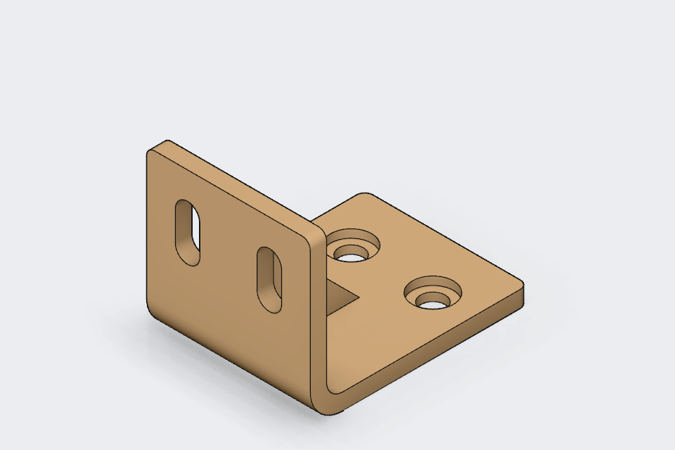

## 03 - Bookshelf

The worked example of `docs/3d-design.md`: 800 x 1800 x 300, two sides
with dados for five shelves, a top, a back panel in a rabbet and three
rails, twelve parts. The joints are cut with the parts themselves
(`cut(side, {part: shelf})`); the shelves share one definition. Exploded
and front views.

[JS source](03-bookshelf.js)

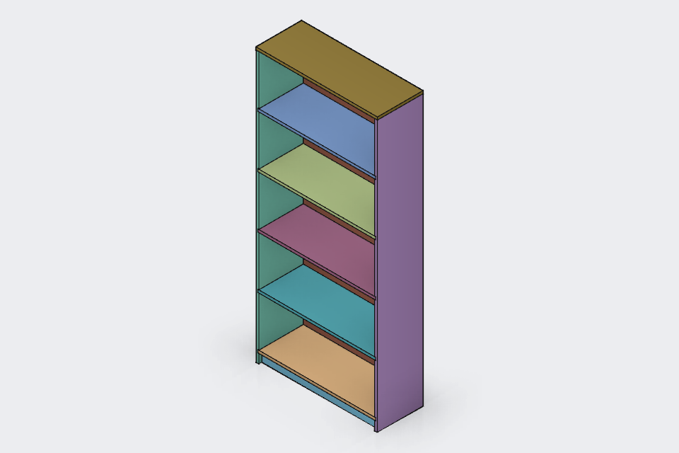

## 04 - Electronics enclosure

A 100 x 60 x 25 case in two halves with 2 mm walls, corner bosses with
screw holes, a board on four standoffs with its larger components as
blocks, and cut-outs for a connector and a jack. Pockets of rounded
rectangles, bosses as unions, holes. Views with the lid lifted and from
the top.

[JS source](04-enclosure.js)

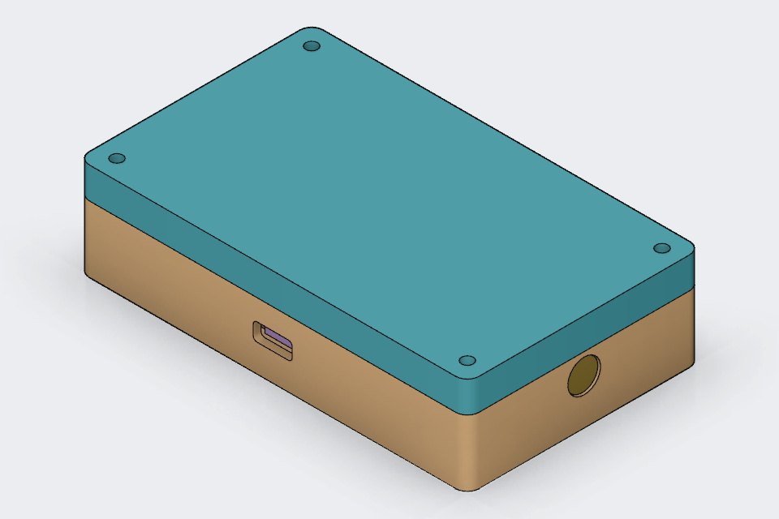

## 05 - Piston and connecting rod

A Ø80 piston with three ring grooves (one revolve), pin bosses with blind
pin bores, a hollow pin, and a rod 140 between centres whose outline is two
circles joined by tangent lines. A quarter cutaway shows them in section.
The bosses are blocks and the pin bores stop short of the skirt: see the
script for why.

[JS source](05-piston-and-rod.js)

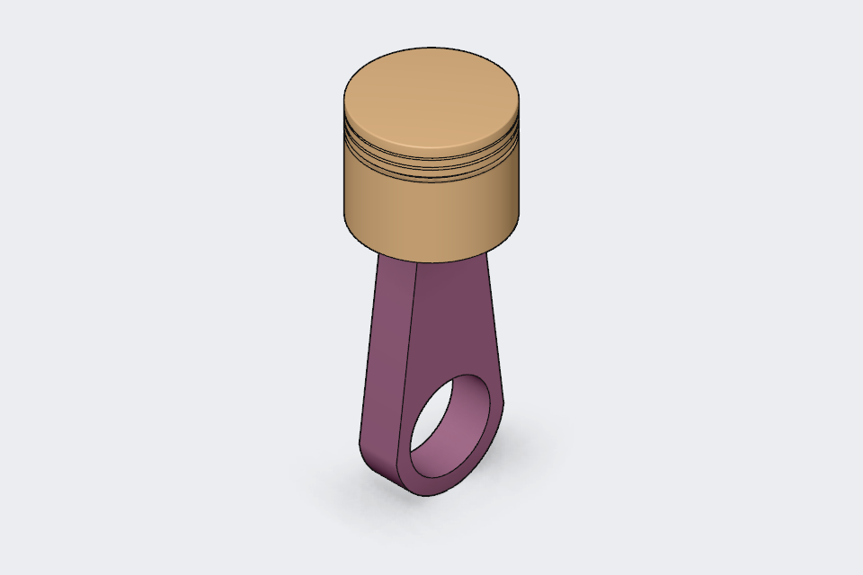

## 06 - Spur gear pair

Module 2, 20 and 40 teeth, meshed at 60 centre distance. Each gear is one
extrude of its whole outline, with one arc per involute flank, a hub, a
bore with a keyway and a chamfer. Front view.

[JS source](06-spur-gears.js)


## 07 - Pipe spool

A Ø60.3 x 3.9 line with two long-radius elbows, swept as one ring along
lines and arcs, three flanges from example 01 (one definition), a stub and
two saddle supports. Top view.

[JS source](07-pipe-spool.js)


## 08 - Turned stool

A round seat with rounded edges on three turned legs splayed 8°, with
beads and a cove (a revolve of lines and arcs), and three tapered
stretchers (ruled lofts). Legs and stretchers are placed by turning copies
about the axis. Front view.

[JS source](08-turned-stool.js)

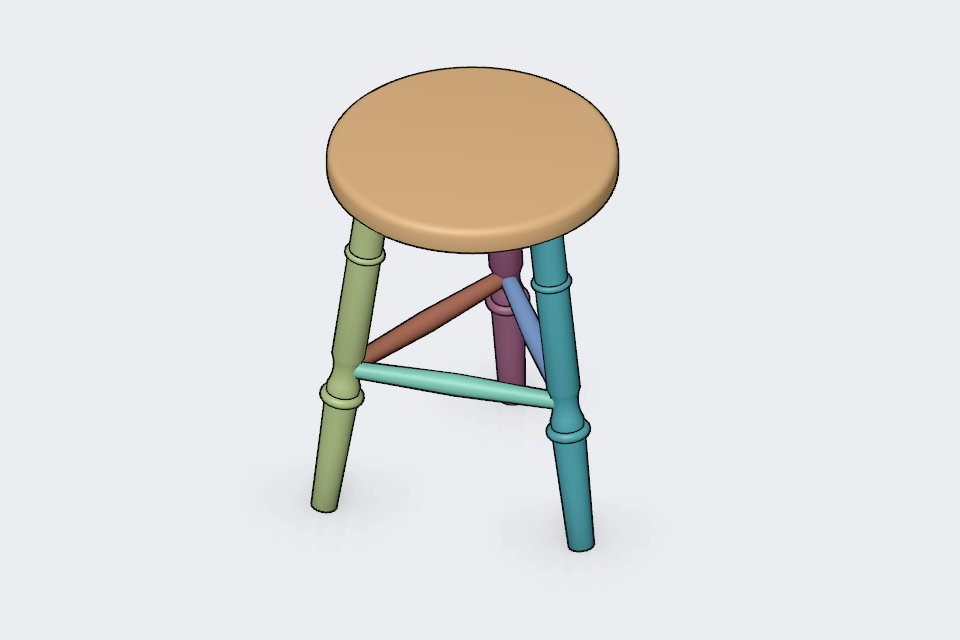

## 09 - Room

The living room of the 2D floor plan `07-floor-plan` in 3D: two external
walls with a window each, two partitions (one with the door), an oak floor
and a ceiling, with the bookshelf of 03 against the north wall and the
stool of 08 in the sunlight from the west window. The walls are typed in
from 07's numbers (a script here cannot read files outside this folder).
The working picture is a dollhouse cut; the presentation render stands
inside in daylight, with the two windows named as portals.

[JS source](09-room.js)

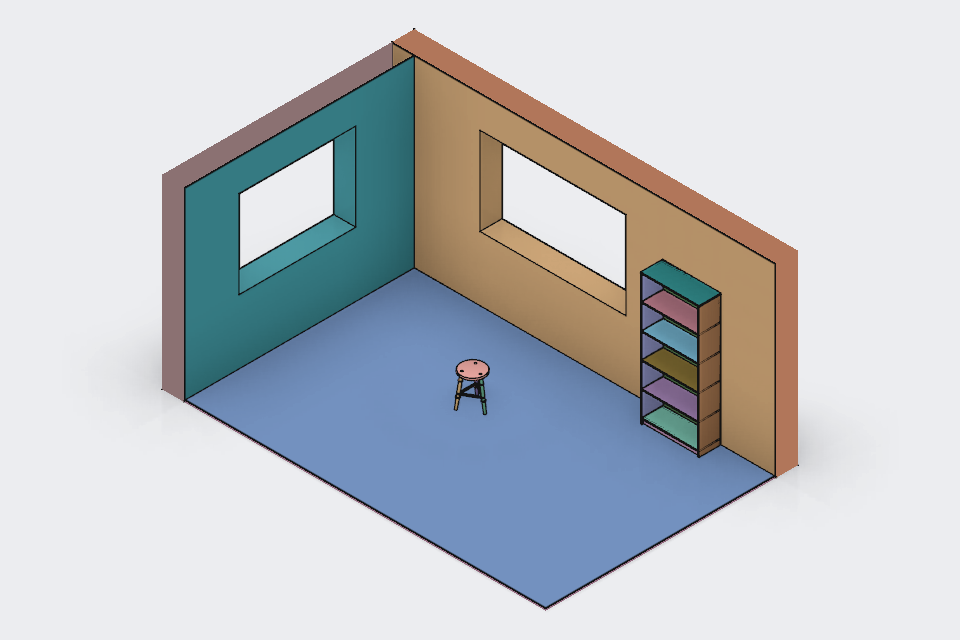

## 10 - Still life

A wine glass, a glazed bowl, a steel flask with its cap and a walnut pepper
mill on an oak table: every object one revolve of exact lines and arcs,
checked against its Pappus volume and against the kernel's rule that no
arc's circle may cross the revolve axis. The presentation render, from a
placed perspective camera, shows refraction through the glass, reflections
on the steel and contact shadows.

[JS source](10-still-life.js)

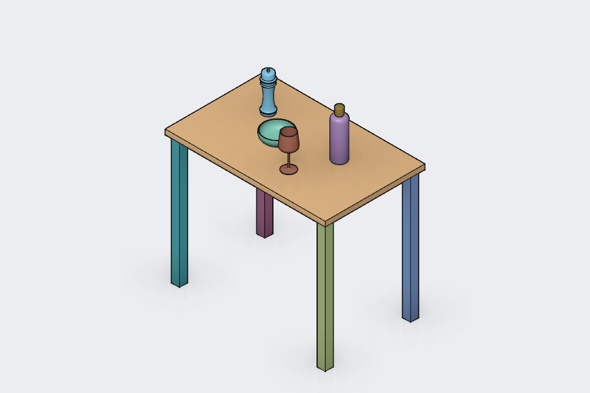

## 11 - Play tower with slide and swings

The flagship, a garden play set of our own design: a 1500 x 1500 platform
at 1450 on four posts, a cabin of board walls with two windows and a door
under a gabled roof, a front railing, stairs with risers and handrails, a
sandbox, a 3 m wave slide and two swings on a beam out to an A-frame. 142
parts in 42 definitions; the slide, the swings and the sand are bought
(`bought: true`). The model is written once, in
[`lib/playtower.js`](lib/playtower.js). Besides its views, the script
renders it from a standing adult's eye height on a lawn (view `eye`, a
placed perspective camera; to the views folder).

The script checks it with rules written in script over the set queries
([`lib/rules.js`](lib/rules.js)): no two parts overlap, every part rests on
what carries it, every post stands on the ground, nothing but the swing
itself in each swing's free space and nothing in the slide's run-out, no
gap that can trap a head or a finger, and a guard on every platform edge
except at the stairs and the slide. The limits are illustrative, not a
safety standard. Seen from the south-west so the stairs face the viewer;
exploded, from the front and from the north-east; and path traced on grass
in daylight.

[JS source](11-play-tower.js)

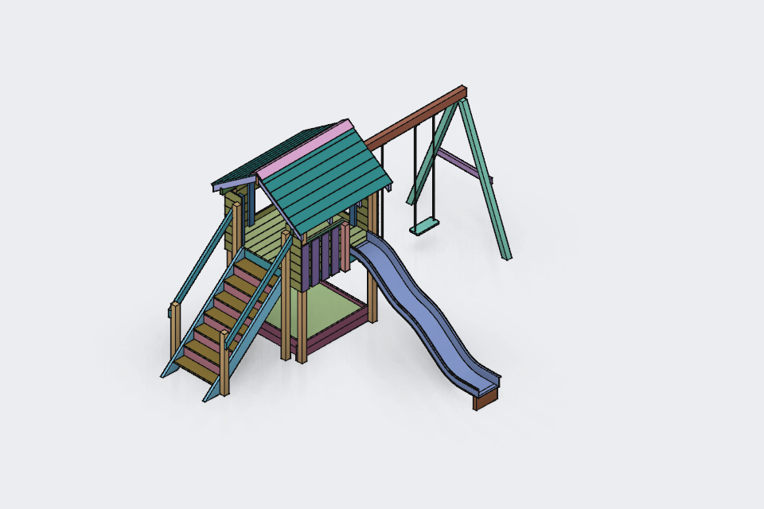

## 11 - Play tower, part list

The same model's part list ([`lib/partlist.js`](lib/partlist.js)), drawn
on one sheet with the 2D API: sawn timber by section and cut length (long
point to long point, with the angles of the end cuts), a cutting plan per
section drawn to scale (first-fit decreasing, 3 mm kerf, offcuts hatched),
the bought items, the fixings counted from the joints by rules of thumb
the model states, and the order of assembly. 157.3 m of timber in 129
pieces from 37 stock lengths, 5.4 % offcut. Saved as a PDF to
`target/3d-views/`.

[JS source](11-play-tower-partlist.js)

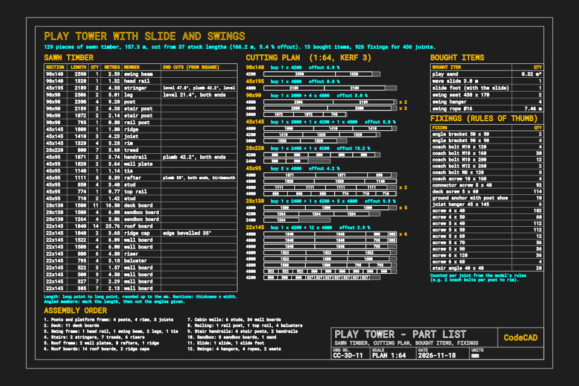

## 11 - Play tower, construction guide

The same model's twelve assembly steps, two per sheet on six sheets
([`lib/guide.js`](lib/guide.js)). Each step is an isometric view of
everything built so far from `cad.project`: the parts this step adds in a
strong orange line, the earlier parts in a thin grey one, told apart by the
`partId` every projected line carries. Each new member is labelled once,
with its count, section and cut length from the part list and a leader to
one of its parts. Markers show where the step's fixings go, one shape per
kind of joint, with a table of the fixings and one line of instruction
whose counts come from the data. Each step is seen from the corner that
leaves its new parts least covered. Larger detail views show the stringer
cuts, the rafter seat on the wall plate and the swing hangers. Each sheet is
saved as a PDF page and a 2D PNG (`target/3d-views/`); the picture here is
the first sheet. The script checks that every part is in exactly one step,
that the label counts and the fixings agree with the part list, and that no
label overlaps the drawing or another label.

[JS source](11-play-tower-guide.js)

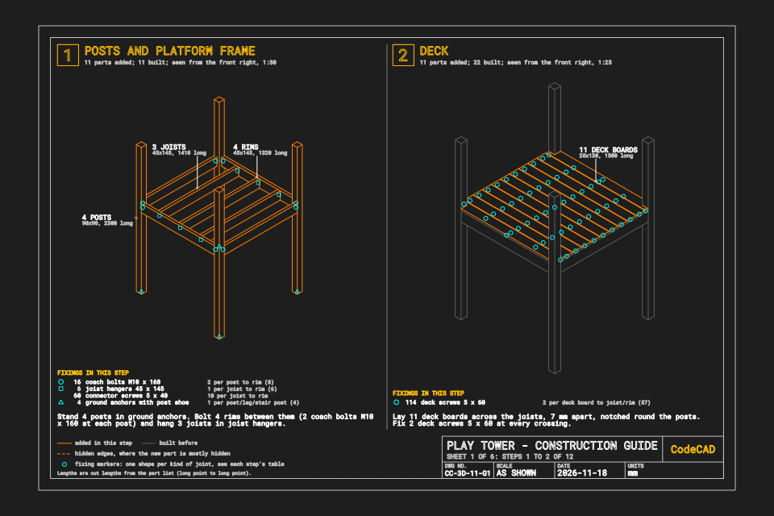

## 12 - Projected views

A shop drawing of a pillow block: a base with R8 corners and two
counterbored bolt holes, an upright with a semicircular top, a chamfered
Ø32 bore and an oil hole into it. Front, top and left views in first-angle
order and an isometric view come from `cad.project` (exact lines, arcs,
circles and ellipses, hidden edges dashed on their own layer), laid out
on an A3 sheet by [`lib/views.js`](lib/views.js) with a title block and
dimensions placed through each view's `toSheet`. Where the oil hole meets
the bore the edge is not a conic; in the front view it lies on the bore's
circle and is drawn as that circle, elsewhere as a fitted spline. Written
as a 2D PNG and a PDF (`target/3d-views/`).

[JS source](12-projected-views.js)

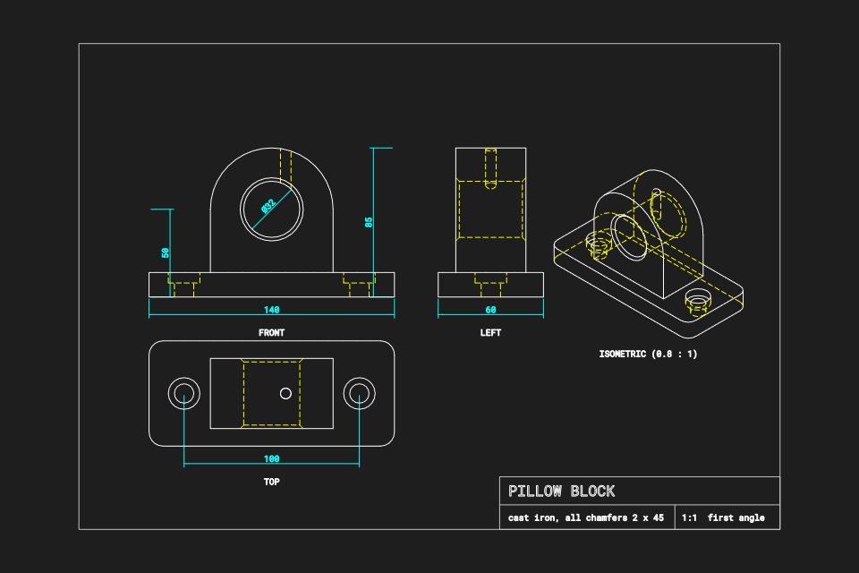
